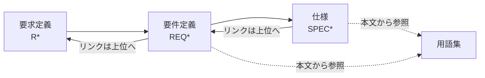
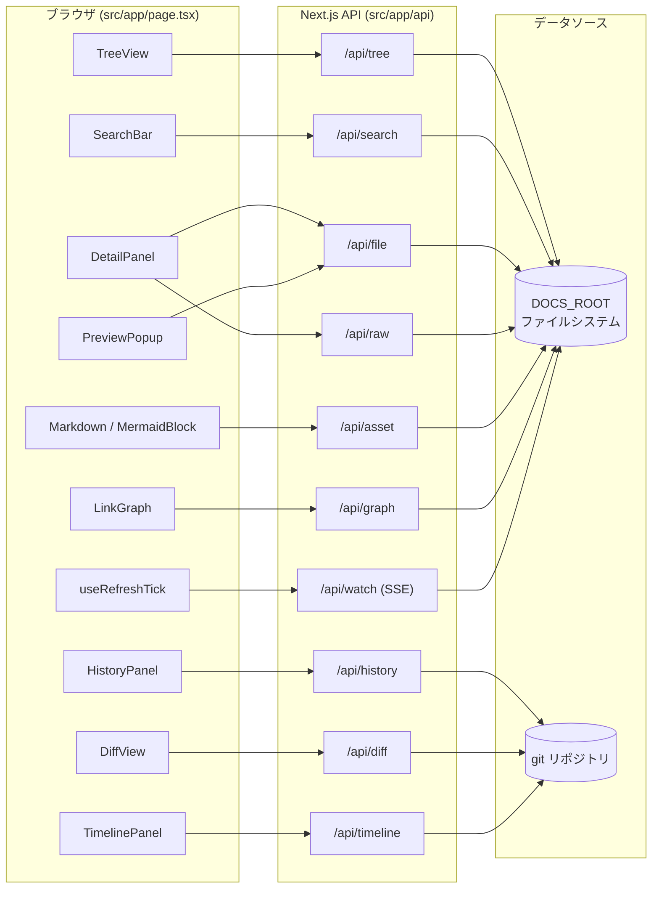

# 仕様

[要件](../要件定義/README.md) を具体的に「どう実装するか」を記述するレイヤ。

## 書き方

- 各仕様は `SPEC{番号}-{テーマ}/README.md` で定義し、より細かい粒度は `SPEC{番号}.{サブ番号}-*.md` に分ける
- 対応する[要件](../要件定義/README.md)へのリンクを本文の冒頭に張る（親フォルダの README だけでなく、子ファイル `SPEC*.{サブ番号}-*.md` にも張ること）
- リンクは常に上位レイヤ（仕様→要件→要求）の一方向のみ張る。双方向にするとリンクグラフが読みづらくなるため

## ドキュメントの階層

実線の右向き矢印は詳細化の流れ、「リンクは上位へ」の矢印が実際にリンクを張る向き。

## 全体構成

画面の各コンポーネントがどの API を呼び、API がどこからデータを読むかの対応。

