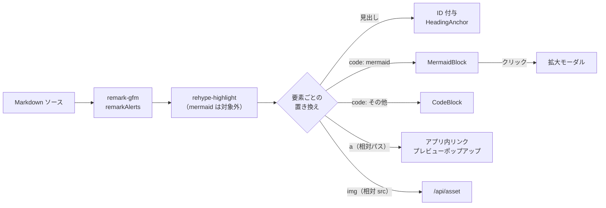

# SPEC3.5: Markdown レンダリング

[REQ3.1 プレビューポップアップ](../../要件定義/REQ3-プレビューとツリー/REQ3.1-プレビューポップアップ.md)、[REQ3.3 目次](../../要件定義/REQ3-プレビューとツリー/REQ3.3-目次.md)、[REQ3.6 画像プレビュー](../../要件定義/REQ3-プレビューとツリー/REQ3.6-画像プレビュー.md) の基盤となる Markdown レンダリング仕様。

## 設計

- 実装: `src/components/Markdown.tsx`（`react-markdown` + `remark-gfm` + `rehype-highlight`）
- GitHub Flavored Markdown（テーブル・タスクリスト・打ち消し線・脚注）を有効化
- スタイルは `src/app/markdown.css`（GitHub 風の閲覧テーマ。md-reader を参考）。`variant` で 2 種類を切り替える
  - `reader`（本文表示）: 本文 16px・行間 1.8、文章は最大幅 860px で中央寄せ（読みやすい行長を保つため）。コードブロック・表・Mermaid 図は内容が収まらない場合のみ最大 1200px（表示領域内）まで中央からはみ出して広がる。h1/h2 に下線
  - `compact`（プレビューポップアップ、既定）: 本文 14px の詰めた表示。コードのコピーボタンは出さない
- アラート: GitHub と同じ `> [!NOTE]`（TIP / IMPORTANT / WARNING / CAUTION、大文字小文字は区別しない）を `src/lib/remarkAlerts.ts` で検出し、色付きの枠とアイコン付きタイトルで表示。マーカーは行に単独で書いたときだけ有効（`> [!NOTE] 本文` は通常の引用）
- テーブルは横スクロール可能な枠で囲み、ヘッダー背景・縞模様・ホバー強調を付ける
- 見出しはカスタムコンポーネントに置き換え、`src/lib/markdown.ts` の `parseHeadings()` で採番した ID を付与（目次のアンカーと一致。[SPEC3.3 TableOfContents](SPEC3.3-TableOfContents.md)）
  - `enableHeadingLinks`（本文表示のみ true、プレビューポップアップは false）のとき、見出しにホバーで現れるリンクアンカー `<HeadingAnchor>` を付ける
  - アンカークリックで `location.hash` を当該見出し ID に更新（`history.replaceState`）し、`?file=...#見出しID` 形式の共有 URL をクリップボードにコピー（コピー後は一時的にチェックアイコンを表示）。共有 URL の初期表示スクロールは [SPEC5.2 URL クエリ](../SPEC5-永続化/SPEC5.2-URLクエリ.md) を参照
  - スクロール到達時に上端へ張り付かないよう `scroll-mt-6` を付与
- コードブロック:
  - `language-mermaid` は `<MermaidBlock>` に差し替え（[Mermaid](../../用語集/Mermaid.md)）。ハイライト対象から外し、元のテキストのまま渡す
    - 図をクリック（ホバー時のカーソルは虫眼鏡）でモーダルを開き、大きく表示する。初期倍率は、小さい図はモーダル幅に合わせて拡大（最大 200%）、大きい図は等倍（文字が読める原寸）とし、はみ出す分はスクロールする
    - モーダルではドラッグで移動、ツールバーの −/＋ ボタン・`+`/`-` キー・Ctrl(⌘)+ホイールで拡大縮小（20%〜500%）、`0` キーかリセットボタンで初期倍率に戻す。`Esc`・背景クリック・閉じるボタンで閉じる
    - モーダルのツールバーの「レイアウト」切り替えで、レイアウトエンジンを `ELK`（Mermaid 12 の標準）と `dagre`（11 以前の標準）から選ぶ。`look`（見た目）は変えない。設定はページ内の全 Mermaid 図に適用し、localStorage（`markshelf:mermaidLayout`、既定の ELK のときは保存しない）に保持する。swimlane は専用レイアウトのまま変えず、図側のフロントマター／ディレクティブで `layout` を指定している場合はそちらを優先する
  - その他は `<CodeBlock>` で表示。言語を明示したフェンスだけを highlight.js（`rehype-highlight`、自動判定なし）で色付けし、GitHub ライト配色を使う
  - 右上に言語名を表示し、ホバーでコピーボタンを出す（コピー処理は見出しアンカーと共通。非セキュアコンテキストでは `execCommand` にフォールバック）
  - Markdown を入れ子で埋め込む場合は CommonMark どおり**外側のフェンスを内側より長く**する（例: 外側 \`\`\`\`、内側 \`\`\`）。同じ長さで入れ子にしたソースは仕様上その時点でブロックが閉じるため、レンダリング結果も途中で切れる
- リンク（`<a>`）:
  - 相対パスは `resolveRelativeLink()` で docs パスへ解決し、解決できたら**アプリ内ナビゲーション**扱い（`` + onClick）
  - ホバー時にプレビューポップアップを表示（`onPreviewShow` / `onPreviewHide`）
- 画像（``）:
  - 相対 src を `/api/asset?path=...` に書き換える（[SPEC3.8 画像プレビュー](SPEC3.8-画像プレビュー.md)）
  - `data:`・プロトコル相対・絶対 URL はそのまま
- 本文テキスト中にファイル名（displayName）が現れても自動ではリンク化しない。リンク表示になるのは明示的なマークダウンリンクのみ

## 処理の流れ

