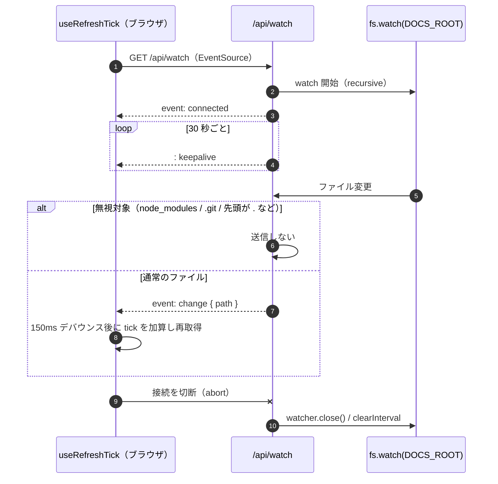

# SPEC4.4: /api/watch (SSE)

[REQ6.1 — SSE による変更通知](../../要件定義/REQ6-ファイル監視/REQ6.1-SSE変更通知.md) の実装。

## 設計

- メソッド: `GET /api/watch`
- Content-Type: `text/event-stream; charset=utf-8`（SSE）
- 送信するイベント:
  - `event: connected` / `data: { "root": "/docs" }` — 接続直後に 1 回
  - `event: change` / `data: { "path": "foo/bar.md" }` — ファイル変更を検知するたび
  - `event: error` / `data: { "message": "..." }` — `fs.watch` が失敗したとき
  - `: keepalive` コメント — 30 秒ごとにプロキシ切断対策で送信
- 監視は `fs.watch(DOCS_ROOT, { recursive: true, persistent: false })`
- 無視対象（ギャップを通らない）: `node_modules`, `.git`, `.next`, `dist`, `.turbo`、先頭が `.` のパス
- `request.signal.abort` で `watcher.close()` と `clearInterval(keepAlive)` を確実に解放
- クライアントは `src/lib/useRefreshTick.ts` の `useRefreshTick()` が購読し、`change` を受け取るたびに再取得トリガを発火

## シーケンス

